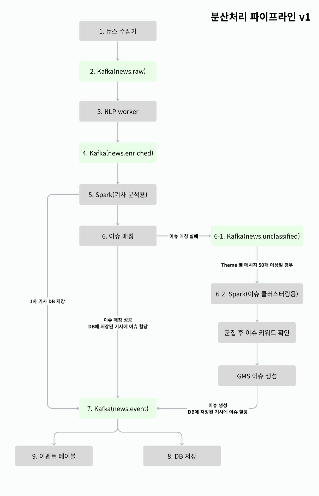

# 분산처리 파이프라인 정리



#### 바로가기

- [1. 뉴스 수집기](#1-뉴스-수집기)
- [2. Kafka(news.raw)](#2-kafkanewsraw)
- [3. NLP worker](#3-nlp-worker)
- [4. Kafka(news.enriched)](#4-kafkanewsenriched)
- [5. Spark(기사 분석용)](#5-spark기사-분석용)
- [6. 이슈 매칭](#6-이슈-매칭)
  - [6-1. Kafka(news.unclassified)](#6-1-kafkanewsunclassified)
  - [6-2. Spark(이슈 클러스터링용)](#6-2-spark이슈-클러스터링용)
- [7. Kafka(news.event)](#7-kafkanewsevent)
- [8. Database 저장](#8-database-저장)
- [9. 이벤트 테이블 저장](#9-이벤트-테이블-저장)


## 1. 뉴스 수집기
뉴스 수집기는 전 세계 언론사의 뉴스 데이터를 수집하여 Kafka의 `news.raw` 토픽으로 전달하는 역할을 담당한다.

### 1-1. 수집 대상 언론사 선정
전 세계 언론사 정보는 MediaCloud를 통해 확인한다.

MediaCloud에서 확보한 전체 언론사 목록을 기반으로, 프로젝트 초기 단계에서는 우선 5개 국가의 언론사만 수집 대상으로 선정한다.

- **초기 대상 국가**: 한국, 미국, 일본, 영국, 독일<br>
- **초기 수집 언론사 수**: 약 330개

이후 각 언론사의 뉴스 제공 방식을 확인하여 다음 두 가지 방식으로 수집 가능한 언론사만 최종 목록에 포함한다.

- **RSS**
- **Sitemap**

즉, 전체 언론사 목록을 그대로 매번 조회하는 것이 아니라 아래와 같은 과정을 통해 수집 가능한 언론사 목록을 사전에 구성한다.

생성된 언론사 목록은 이후 반복적으로 활용한다.
<hr>

### 1-2. 뉴스 수집 주기
뉴스 수집은 10분 주기로 실행된다.

- 수집 시작
- 언론사 목록 조회
- 각 언론사의 RSS / Sitemap 확인
- 새롭게 등록된 기사 탐색
- 기사 본문 및 메타데이터 수집

수집기는 사전에 구성된 언론사 목록을 기준으로 각 언론사의 RSS 또는 Sitemap을 확인하며, 새롭게 발견된 기사만 수집한다.
<hr>

### 1-3. 수집 방식
언론사<br>
  │<br>
  ├─ RSS 지원 ───────► RSS 기반 기사 탐색<br>
  │<br>
  └─ Sitemap 지원 ──► Sitemap 기반 기사 탐색<br>

하나의 언론사가 여러 수집 Endpoint를 제공할 수 있으며, 수집기는 각 Endpoint를 기준으로 새로운 기사 URL을 탐색한다.
<hr>

### 1-4. 수집 결과
새로운 기사가 발견되면 기사 본문과 함께 수집에 필요한 메타데이터를 생성한다.

수집 결과 예시는 다음과 같다.

```json
{
	"source_id":"622913",
	"source_name":"Hankook Ilbo - South Korea (Korean)",
	"country":"South Korea",
	"article_url":"https://www.hankooki.com/news/articleView.html?idxno=342372",
	"published_at": "2026-09-01T08:15:03+00:00",
	"discovered_at": "2026-09-01T08:22:28.256121+00:00",
	"discovery_type":"SITEMAP",
	"endpoint_url":"https://www.hankooki.com/sitemap.xml",
	"success":true,
	"http_status":200,
	"title":"국가철도공단, 정진혁 신임 이사장 취임…CEO 공백 종료",
	"body":"[데일리한국 정백현 기자] 5개월여 간 공백이었던 국가철도공단의 새 이사장에...",
	"body_length":1036,
	"elapsed_ms":87,
	"error": null
}
```
## 2. Kafka(news.raw)


## 3. NLP worker


## 4. Kafka(news.enriched)


## 5. Spark(기사 분석용)


## 6. 이슈 매칭


### 6-1. Kafka(news.unclassified)


### 6-2. Spark(이슈 클러스터링용)


## 7. Kafka(news.event)


## 8. Database 저장


## 9. 이벤트 테이블 저장