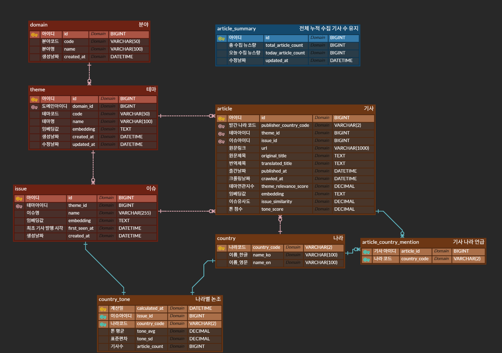

# ERD 및 각 테이블 설명

## 분야

| 컬럼 | 설명 |
|---|---|
| `id` | 분야 ID |
| `code` | 분야 식별 코드 |
| `name` | 분야명 |
| `created_at` | 생성 일시 |

---

## 테마

| 컬럼 | 설명 |
|---|---|
| `id` | 테마 ID |
| `domain_id` | 소속 분야 ID |
| `code` | 테마 식별 코드 |
| `name` | 테마명 |
| `embedding` | 테마 임베딩 값 |
| `created_at` | 생성 일시 |
| `updated_at` | 수정 일시 |

---

## 이슈

| 컬럼 | 설명 |
|---|---|
| `id` | 이슈 ID |
| `theme_id` | 소속 테마 ID |
| `name` | 이슈명 |
| `embedding` | 이슈 임베딩 값 |
| `first_seen_at` | 이슈가 최초 등장한 일시 |
| `created_at` | 생성 일시 |

---

## 기사

| 컬럼 | 설명 |
|---|---|
| `id` | 기사 ID |
| `publisher_country_code` | 기사를 발행한 국가 코드 |
| `theme_id` | 기사에 분류된 테마 ID |
| `issue_id` | 기사에 분류된 이슈 ID |
| `url` | 원문 기사 URL |
| `original_title` | 원문 제목 |
| `translated_title` | 번역된 제목 |
| `published_at` | 기사 발행 일시 |
| `crawled_at` | 기사 수집 일시 |
| `theme_relevance_score` | 기사와 테마의 관련도 점수 |
| `embedding` | 기사 임베딩 값 |
| `issue_similarity` | 기사와 이슈의 유사도 점수 |
| `tone_score` | 기사의 논조 점수 |

---

## 나라

| 컬럼 | 설명 |
|---|---|
| `country_code` | 국가 코드 |
| `name_ko` | 국가 한글명 |
| `name_en` | 국가 영문명 |

---

## 나라별 논조

| 컬럼 | 설명 |
|---|---|
| `calculated_at` | 논조 통계 계산 일시 |
| `issue_id` | 대상 이슈 ID |
| `country_code` | 대상 국가 코드 |
| `tone_avg` | 해당 국가의 평균 논조 점수 |
| `tone_sd` | 논조 점수 표준편차 |
| `article_count` | 통계 계산에 사용된 기사 수 |

---

## 기사 나라 언급

| 컬럼 | 설명 |
|---|---|
| `article_id` | 기사 ID |
| `country_code` | 기사에서 언급된 국가 코드 |

---

## 전체 누적 수집 기사 수 유지

| 컬럼 | 설명 |
|---|---|
| `id` | 집계 데이터 ID |
| `total_article_count` | 전체 누적 수집 기사 수 |
| `today_article_count` | 오늘 수집된 기사 수 |
| `updated_at` | 집계 갱신 일시 |